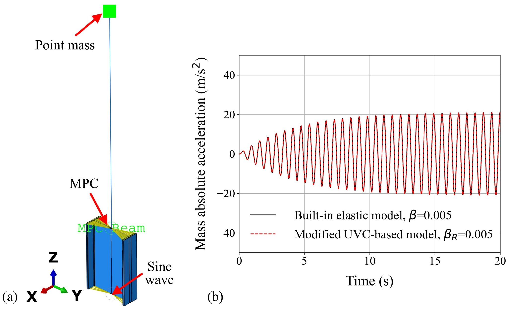
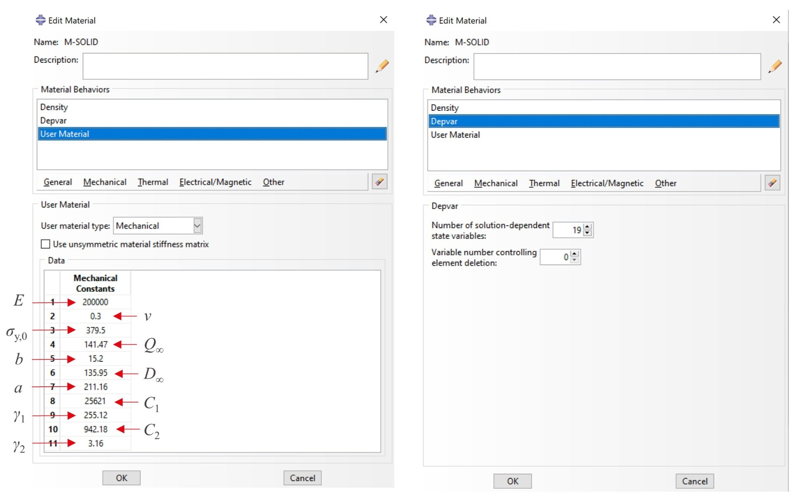
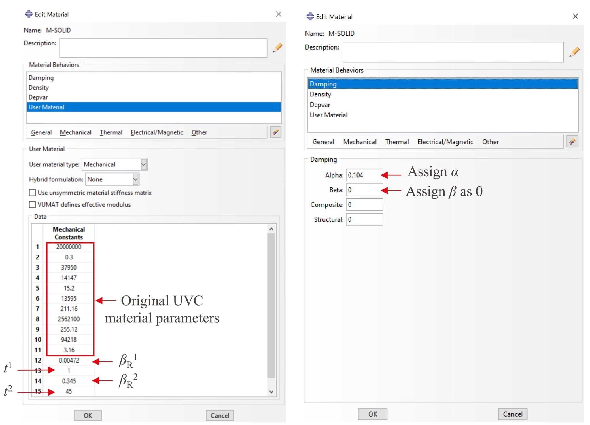

# UVC Material Model for Abaqus with Optional Stiffness-Proportional Damping

This directory provides Updated Voce–Chaboche (UVC) user material subroutines for Abaqus/Standard. The constitutive model combines nonlinear isotropic and kinematic hardening to describe structural steels under cyclic loading; see Hartloper et al. (2021).

The implementation is based on the **[RESSLab version of UVC](https://github.com/RESSLab-Team/UVC_MatMod)** and includes optional, time-dependent stiffness-proportional damping. All four UMATs, including the uniaxial residual-stress variant, provide this damping option within the UVC model.



**Figure 1.** Elastic-response comparison: (a) a point mass connected through an MPC beam constraint to the top of a wide-flange member subjected to sinusoidal base excitation; (b) point-mass absolute acceleration from a built-in elastic material with $\beta=0.005$ and UVC operating in its elastic range with $\beta_R=0.005$.

The plotted responses closely overlap for this example. This comparison illustrates the elastic damping contribution; it does not by itself validate nonlinear cyclic response, every stress-state implementation, or compiler compatibility. The figure is supplied as documentation; a corresponding runnable model, raw response data, and validation slides are not included in this package.

**Contents:** [Installation](#1-files-and-installation) · [Inputs and Depvar](#2-material-constants-and-depvar) · [Damping](#3-stiffness-proportional-damping-implementation) · [Output](#4-state-variables-and-stress-output) · [Sections](#5-beam-and-shell-sections-hourglass-control) · [Units](#6-units-and-convergence-tolerances) · [Residual stress](#7-separate-uniaxial-residual-stress-variant) · [Examples](#8-examples-and-verification)

## 1. Files and installation

| Subroutine | Intended stress state | Optional damping |
|---|---|---|
| [UVCuniaxial.for](UVCuniaxial.for) | Uniaxial response, e.g. trusses and beam axial/flexural response | Yes |
| [UVCplanestress.for](UVCplanestress.for) | Plane stress, e.g. conventional shells | Yes |
| [UVCmultiaxial.for](UVCmultiaxial.for) | Three-dimensional solids, with six stress components | Yes |
| [UVCuniaxial_IS.for](UVCuniaxial_IS.for) | Uniaxial response with the Young (1972) residual stress distribution for I-shaped sections | Yes; input layout in Section 7 |

These are `UMAT` subroutines for Abaqus/Standard, not `VUMAT` subroutines for Abaqus/Explicit. The damping extension is intended for time-domain analysis. Use the subroutine corresponding to the element's stress state; the multiaxial implementation is not a four-component plane-strain implementation.

### Prerequisites and source files

Use Abaqus linked to a compatible Fortran compiler, and make the selected `.for` file available to the job. The RESSLab reference repository can be obtained with:

```bash
git clone https://github.com/RESSLab-Team/UVC_MatMod.git
```

Use the UMAT files bundled with this package for the input definitions and damping option documented below.

Historical testing of the reference implementation used Abaqus 6.14, Intel Fortran (`ifort`), and Visual Studio Community 2013. Those results do not establish compatibility of this modified package with every later Abaqus/compiler combination. Consult the [compiler notes in the main README](../README.md#abaqus-and-fortran-compiler-compatibility) and the compiler requirements for your installed Abaqus release.

### Selecting a subroutine

In Abaqus/CAE, open the job editor and select the file under **General → User subroutine file**. For a command-line run, for example:

```bash
abaqus job=MyModel user=UVCmultiaxial.for interactive
```

This assumes `MyModel.inp` and the selected subroutine are in the working directory. Each file defines `UMAT`; select one appropriate file per job.

## 2. Material constants and Depvar

Create a material using **General → User Material → Mechanical**. Enter the constants in the order below and set **General → Depvar → Number of solution-dependent state variables** to the exact corresponding count.

Each subroutine can run with or without the added stiffness-proportional damping. It determines the mode from the combination of `NPROPS` (number of constants) and `NSTATV` (Depvar). **The four damping constants must be the last four inputs.** They follow all backstress pairs; in `UVCuniaxial_IS.for`, the six geometry and integration-point inputs also precede them.

### Constitutive parameters

Let $N\geq 1$ be the number of backstresses. Each $C_k$ must be followed by its corresponding $\gamma_k$.

| Parameter | Meaning | Uniaxial position | Plane-stress / multiaxial position |
|---|---|---:|---:|
| $E$ | Young's modulus | 1 | 1 |
| $\nu$ | Poisson's ratio | Not entered | 2 |
| $\sigma_{y,0}$ | Initial yield stress | 2 | 3 |
| $Q_\infty$ | Saturation magnitude of isotropic hardening | 3 | 4 |
| $b$ | Rate parameter for $Q_\infty$ | 4 | 5 |
| $D_\infty$ | Saturation magnitude of the initial reduction in yield stress; set to zero to omit this term | 5 | 6 |
| $a$ | Rate parameter for $D_\infty$; use a nonzero value | 6 | 7 |
| $C_k$ | Kinematic hardening modulus for backstress $k$ | $5+2k$ | $6+2k$ |
| $\gamma_k$ | Dynamic recovery parameter for backstress $k$; use a nonzero value | $6+2k$ | $7+2k$ |

Here $k=1,\ldots,N$. For a uniaxial backstress, $C_k/\gamma_k$ is its saturation magnitude; $C_k$ itself is not that saturation magnitude.

The input sequences are:

```text
Uniaxial:
E, sy0, QInf, b, DInf, a, C1, gamma1, ..., CN, gammaN

Plane stress / multiaxial:
E, nu, sy0, QInf, b, DInf, a, C1, gamma1, ..., CN, gammaN
```

### Optional damping parameters

To enable the extension, append all four values in exactly this order:

```text
..., CN, gammaN, beta_R1, t1, beta_R2, t2
```

For `UVCuniaxial_IS.for`, insert the six residual-stress inputs between `gammaN` and `beta_R1`, as detailed in Section 7.

| Parameter | Meaning | Position in `PROPS` |
|---|---|---|
| $\beta_R^1$ | Stiffness-proportional damping coefficient for $t^1\leq t<t^2$ | `NPROPS - 3` |
| $t^1$ | Total time at which the first damping stage begins | `NPROPS - 2` |
| $\beta_R^2$ | Stiffness-proportional damping coefficient for $t\geq t^2$ | `NPROPS - 1` |
| $t^2$ | Total time at which the second damping stage begins | `NPROPS` |

Use $0\leq t^1<t^2$ and nonnegative damping coefficients for the staged damping described here. For constant stiffness-proportional damping from the start, use $t^1=0$ and $\beta_R^1=\beta_R^2$, with $t^2>0$.

### Required counts

The counts depend on whether the optional UMAT stiffness-proportional damping inputs are included. Mass-proportional damping is configured separately.

| Subroutine | Constants: damping disabled | Depvar: damping disabled | Constants: damping enabled | Depvar: damping enabled |
|---|---:|---:|---:|---:|
| Uniaxial | $6+2N$ | $1+N$ | $10+2N$ | $2+N$ |
| Plane stress | $7+2N$ | $4+3N$ | $11+2N$ | $7+3N$ |
| Multiaxial | $7+2N$ | $7+6N$ | $11+2N$ | $13+6N$ |
| Uniaxial with residual stress (`IS`) | $12+2N$ | $1+N$ | $16+2N$ | $2+N$ |

For **two backstresses** ($N=2$):

| Subroutine | Constants / Depvar: damping disabled | Constants / Depvar: damping enabled | Damping input positions |
|---|---:|---:|---|
| Uniaxial | 10 / 3 | 14 / 4 | 11–14 |
| Plane stress | 11 / 10 | 15 / 13 | 12–15 |
| Multiaxial | 11 / 19 | 15 / 25 | 12–15 |
| Uniaxial with residual stress (`IS`) | 16 / 3 | 20 / 4 | 17–20 |

Do not allocate extra SDVs “just in case”: the code uses the exact Depvar count to identify the input layout and exits if neither layout matches. Supply complete backstress pairs and exactly the required constants. Setting both damping coefficients to zero while retaining all four damping inputs still requires the damping-enabled Depvar count.

## 3. Stiffness-proportional damping implementation

Rayleigh damping is conventionally expressed as

$$
\mathbf C=\alpha\mathbf M+\beta\mathbf K.
$$

For a user material, Abaqus allows mass-proportional damping to be assigned separately; stiffness-proportional damping must be implemented in the stress and Jacobian definitions of the UMAT. See [User-Defined Mechanical Material Behavior](https://docs.software.vt.edu/abaqusv2026/English/SIMACAEMATRefMap/simamat-c-usermat.htm).

The supplied extension uses the **elastic material stiffness** $\mathbf D^{el}$, rather than the evolving elastoplastic tangent, to calculate its damping stress. For $\Delta t>0$:

$$
\boldsymbol\sigma_m
=\boldsymbol\sigma_{\mathrm{UVC}}
+\beta_R(t)\mathbf D^{el}\frac{\Delta\boldsymbol\varepsilon}{\Delta t},
$$

$$
\mathbf D_m^{\mathrm{tg}}
=\mathbf D_{\mathrm{UVC}}^{\mathrm{tg}}
+\frac{\beta_R(t)}{\Delta t}\mathbf D^{el}.
$$

For uniaxial response, replace $\mathbf D^{el}$ with $E$. The time-dependent coefficient is

$$
\beta_R(t)=
\begin{cases}
0, & t\lt t_1\cr
\beta_R^{1}, & t_1\leq t\lt t_2\cr
\beta_R^{2}, & t\geq t_2
\end{cases}
$$

The implementation stores the constitutive stress $\boldsymbol\sigma_{\mathrm{UVC}}$ in the additional SDVs before adding the damping stress to `STRESS`. The next increment starts from this stored constitutive stress, so the damping stress is not accumulated as plasticity-model stress. Both stress and `DDSDDE` receive the damping contribution. When `DTIME <= 0`, the added damping contribution is skipped.

### Time convention and activation

The switch uses **`TIME(2)`, the total time at the beginning of the current increment**, as defined in the [Abaqus UMAT interface](https://docs.software.vt.edu/abaqusv2026/English/SIMACAESUBRefMap/simasub-c-umat.htm). It does not use step time or the time at the end of the increment. Thus, the selected coefficient applies throughout that increment. Place step boundaries at the switching times if exact alignment is required.

The accumulated time includes preceding general steps. For example, after a static gravity step with a nominal duration of 1, choose $t^1=1$ to start the first damping stage at the beginning of the following dynamic step. If that dynamic stage lasts 44, its end is at total time $t^2=45$.

The code does not identify whether a step is static or dynamic. A static step that reaches an active time range also receives the added rate-dependent term. Set the time thresholds to match the intended loading sequence.

### Abaqus damping settings

Under **Mechanical → Damping**, assign the required mass-proportional coefficient $\alpha$ and set the material **Beta field to zero**. Enter $\beta_R^1$ and $\beta_R^2$ only in the User Material constants. Mass-proportional damping is optional; use $\alpha=0$ if it is not required. The UMAT's time switches control only its added stiffness-proportional term, not $\alpha$.



**Figure 2.** UVC material setup with two backstresses and optional damping. The red box encloses the constitutive parameters, followed by the four damping inputs in positions 12–15: $\beta_R^1=0.00472$, $t^1=1$, $\beta_R^2=0.345$, and $t^2=45$. The Abaqus damping dialog shows $\alpha=0.104$ and Beta = 0. For the multiaxial subroutine, this setup requires **Depvar = 25**; for plane stress it requires **13**.

The stress-valued constants shown in Figure 2 use N/cm². The input-file example below expresses the same constitutive parameters in N/mm², so those values are divided by 100. Use one consistent unit system throughout the actual model. The damping coefficients are example values, not a general calibration.



**Figure 3.** Illustration of the two damping stages in a moment-resisting frame analysis. The phrase “No damping before $t^1$” in the image refers only to the optional **stiffness-proportional** term. A larger second-stage coefficient suppresses free vibration to assist residual-drift evaluation in this example; its value and activation time should be chosen for the intended post-motion analysis.

### Input-file example: multiaxial, two backstresses

The following UVC material block uses the parameters in Figure 2, with stress-valued constants converted to N/mm² and time measured in seconds:

```text
*Material, name=UVC
*Damping, alpha=0.104, beta=0.
*Depvar
25,
*User Material, constants=15
200000., 0.3, 379.5, 141.47, 15.2, 135.95, 211.16, 25621.
255.12, 942.18, 3.16, 0.00472, 1., 0.345, 45.
```

This is a material-definition example, not a complete dynamic model. Define the model's density and/or point masses, sections, loading, and analysis steps consistently. To use the same multiaxial material without the added damping term, omit the last four constants, set `constants=11`, and set Depvar to 19. For the plane-stress file, the same constant sequence applies but Depvar is 13 with damping or 10 without it. For uniaxial response, omit Poisson's ratio and use the counts in Section 2.

## 4. State variables and stress output

Request **SDV** field output to obtain the internal variables. Equivalent plastic strain is stored in `SDV1`; use it when evaluating the UVC plasticity response. All indices below are one-based and $k=1,\ldots,N$.

| Subroutine | State variables retained in both modes | Additional SDVs with damping |
|---|---|---|
| Uniaxial, including `IS` | `SDV1`: equivalent plastic strain; `SDV(1+k)`: backstress $k$ | `SDV(N+2)`: constitutive axial stress |
| Plane stress | `SDV1`: equivalent plastic strain; `SDV2–4`: plastic strains 11, 22, 12; backstress $k$ occupies three entries starting at `5+3(k-1)` | Three entries starting at `5+3N`: constitutive stresses 11, 22, 12 |
| Multiaxial | `SDV1`: equivalent plastic strain; `SDV2–7`: plastic strains 11, 22, 33, 12, 13, 23; backstress $k$ occupies six entries starting at `8+6(k-1)` | Six entries starting at `8+6N`: constitutive stresses 11, 22, 33, 12, 13, 23 |

Plastic shear strains use the UMAT engineering-shear convention. Backstress components use the same component order as stress. The multiaxial backstress blocks advance by **six** entries for each backstress.

With two backstresses, the added constitutive-stress outputs are `SDV4` for both uniaxial variants, `SDV11–13` for plane stress, and `SDV20–25` for multiaxial response. In the `IS` variant, this constitutive stress includes the residual-stress initialization and subsequent constitutive evolution, while excluding the added damping stress.

In damping-enabled mode, the returned `STRESS` and corresponding **S** output include the added damping stress. Use the appended SDVs to recover the constitutive stress without that contribution; subtract them from the corresponding S components to obtain the added damping stress. The supplied routines do not separately accumulate damping energy in `SSE`, `SPD`, or `SCD`.

## 5. Beam and shell sections; hourglass control

The section settings from the RESSLab version remain relevant when using the damping extension.

### Beam transverse shear stiffness

For shear-flexible beam sections, specify the transverse shear stiffness under **Sections → Edit Section → Stiffness → Specify Transverse Shear**. The reference guidance uses

$$
K_{13}=K_{23}=kAG,\qquad G=\frac{E}{2(1+\nu)},
$$

where $A$ is the cross-sectional area and $k$ is the section shear correction factor. The reference example uses $k=0.44$ for an I-shaped section; select the appropriate section-dependent values for the actual model. Poisson's ratio is needed for this section calculation even though it is not an input to the uniaxial UMAT.

### Shell transverse shear stiffness

For a homogeneous isotropic shell of thickness $h$, the reference setup uses

$$
K_{11}=K_{22}=\frac{5}{6}Gh,\qquad K_{12}=0.
$$

Enter these values under **Sections → Edit Section → Advanced → Transverse Shear Stiffnesses → Specify Values**. Other section constructions require their appropriate shear stiffnesses.

### Reduced-integration elements

The reference setup recommends **Enhanced** hourglass control for reduced-integration elements such as S4R and C3D8R: **Element Type → Hourglass Control → Enhanced**. Menu wording can vary by Abaqus release. The added UMAT damping stress acts on the constitutive stress components; it does not implement separate damping of section transverse shear or hourglass contributions.

## 6. Units and convergence tolerances

Abaqus requires a consistent unit system. The constitutive parameters $E$, $\sigma_{y,0}$, $Q_\infty$, $D_\infty$, and $C_k$ have stress units. The rates $b$, $a$, and $\gamma_k$ are per unit plastic strain. The damping coefficients $\beta_R^1$ and $\beta_R^2$ have time units, $\alpha$ has inverse-time units, and $t^1$, $t^2$ have time units.

The routines use absolute convergence tolerances. The supplied defaults are `TOL=1D-10` for multiaxial, `1D-8` for plane stress, and `1D-10` for uniaxial response. The multiaxial residual has stress units; the plane-stress and uniaxial yield residuals have stress-squared units. Consequently, a change of stress units requires corresponding scaling of `TOL` as well as of the material parameters.

The following values preserve the same dimensional tolerance when converting from the supplied N–mm convention while keeping force in Newtons:

| Subroutine | N–mm | N–cm | N–dm | N–m |
|---|---:|---:|---:|---:|
| Multiaxial | `1D-10` | `1D-8` | `1D-6` | `1D-4` |
| Plane stress | `1D-8` | `1D-4` | `1D0` | `1D4` |
| Uniaxial | `1D-10` | `1D-6` | `1D-2` | `1D2` |

These are unit conversions of the default tolerances, not independently validated optimal settings for every problem. Changing length units alone does not change $\beta_R$ when the time unit is unchanged. Density, loads, geometry, section stiffnesses, and all other inputs must also be consistent.

## 7. Separate uniaxial residual-stress variant

[UVCuniaxial_IS.for](UVCuniaxial_IS.for) retains the Young (1972) residual stress distribution for I-shaped sections from the RESSLab version and adds the same optional damping formulation as `UVCuniaxial.for`.

After the $6+2N$ uniaxial constitutive parameters, append these six values:

| Order after the last backstress pair | Parameter | Meaning |
|---:|---|---|
| 1 | `dcl` | Flange-to-flange centerline depth, $d-t_f$ |
| 2 | `bf` | Flange width |
| 3 | `tf` | Flange thickness |
| 4 | `tw` | Web thickness |
| 5 | `npt_flange` | Number of integration points on each flange |
| 6 | `npt_web` | Number of integration points along the web |

To enable damping, append the four damping constants **after these six inputs**:

```text
E, sy0, QInf, b, DInf, a, C1, gamma1, ..., CN, gammaN,
dcl, bf, tf, tw, npt_flange, npt_web,
beta_R1, t1, beta_R2, t2
```

| Mode | Number of constants | Depvar | Counts for two backstresses |
|---|---:|---:|---|
| Without added damping | $12+2N$ | $1+N$ | 16 constants; Depvar = 3 |
| With added damping | $16+2N$ | $2+N$ | 20 constants; Depvar = 4 |

The integration-point inputs must match the beam section definition. At `TIME(2) = 0`, the Young residual stress is added to the incoming axial stress. In damping-enabled mode, this combined initial stress initializes the additional stress SDV; subsequent increments use the stored constitutive stress. The residual-stress function receives only its six inputs, excluding the four damping constants.

For two backstresses, the following example uses the constitutive and section values in `Lamarche-1-Beam.inp`, followed by the illustrative damping settings used above:

```text
*Material, name=UVC_IS
*Damping, alpha=0.104, beta=0.
*Depvar
4,
*User Material, constants=20
200000., 373.72, 141.47, 15.2, 135.95, 211.16, 25621., 235.12
942.18, 3.16, 297.4, 307., 20.6, 13.1, 5., 5.
0.00472, 1., 0.345, 45.
```

This is a material block; the model still requires compatible section integration, mass, loading, and analysis-step definitions. For this layout, `SDV4` is the constitutive axial stress without the damping term. For the same material without added damping, omit the final four constants and use 16 constants with Depvar = 3.

The residual-stress function retains fixed numerical stress coefficients (e.g. 165 and 100, in the reference MPa convention); these also require conversion if another stress unit is used. The uniaxial tolerance guidance in Section 6 applies to both uniaxial variants.

## 8. Examples and verification

### Existing cyclic examples

The [testing directory](testing/readme.md) retains the reference cyclic input decks. They use the constitutive input layout without the four damping parameters. Some contain extra SDV allocations that must be corrected before use with the current automatic layout detection:

| Input deck | Subroutine | Required Depvar for its active two-backstress material |
|---|---|---:|
| `Truss-UMAT-Disp-Cyclic.inp` | `UVCuniaxial.for` | 3 (deck currently specifies 8) |
| `Truss-UMAT-Force-Cyclic.inp` | `UVCuniaxial.for` | 3 (active `UMAT` material currently specifies 4) |
| `Shell-Biaxial-UMAT.inp` | `UVCplanestress.for` | 10 (already matches) |
| `Cube_Cyclic_Disp_UMAT.inp` | `UVCmultiaxial.for` | 19 (deck currently specifies 28) |
| `Lamarche-1-Beam.inp` | `UVCuniaxial_IS.for` | 3 (deck currently specifies 4) |

The force-controlled truss deck also contains an unused six-constant `UMAT-Iso-Only` material. The main UMAT requires at least one backstress; that unused material is not a supported zero-backstress example. The separate `Lamarche-1-Beam.inp` example uses `UVCuniaxial_IS.for`.

The input decks have been retained unchanged and have not been rerun in Abaqus for this update. Historical reference-test results are described in the testing README.

The `IS` damping extension was compiled with GNU Fortran 14.2 and checked using a standalone driver with a minimal substitute for `ABA_PARAM.INC`. Checks passed for cyclic response against the supplied undamped `IS` routine, one to three backstresses, flange and web section points, initial residual stress, zero damping coefficients, both damping stages and their switching times, zero time increments, and the added tangent contribution. Invalid Depvar layouts and zero backstresses were also rejected as intended. Abaqus/compiler integration and complete Abaqus analyses remain to be verified separately.

### Source-version note

The damping extension is based on the RESSLab version supplied with the 16-Nov-2026 constitutive updates. These updates are retained in the supplied UMATs:

- The multiaxial implementation recomputes the yield-surface normal within the return-mapping loop and uses the corresponding updated consistent tangent.
- Both uniaxial implementations evaluate the backstress exponential using the accumulated plastic strain increment, `ABS(e_p_total)`.
- The plane-stress implementation evaluates the backstress exponentials using `dep_eq`, with `ep_eq = ep_eq_init + dep_eq`.

The uniaxial and plane-stress evaluations therefore retain the direct-increment treatment introduced in the RESSLab update to avoid rounding errors from subtracting accumulated equivalent plastic strains. The optional damping adds input-layout detection, storage of the constitutive stress, and damping contributions to stress and the Jacobian. The supplied `UVCuniaxial.for`, `UVCplanestress.for`, and `UVCmultiaxial.for` remain unchanged. `UVCuniaxial_IS.for` has been extended to include this damping while preserving its constitutive update and residual-stress functions.

## References and attribution

1. **RESSLab version of UVC:** [RESSLab-Team/UVC_MatMod](https://github.com/RESSLab-Team/UVC_MatMod).
2. Hartloper, A. R., de Castro e Sousa, A., and Lignos, D. G. (2021). “Constitutive Modeling of Structural Steels: Nonlinear Isotropic/Kinematic Hardening Material Model and Its Calibration.” *Journal of Structural Engineering*, 147(4), 04021031. [DOI](https://doi.org/10.1061/(ASCE)ST.1943-541X.0002964).
3. Suchocki (2022), return-mapping and tangent formulation referenced by the multiaxial implementation. [DOI](https://doi.org/10.1007/s00707-021-03069-3).
4. Dassault Systèmes. *Abaqus Documentation*: [User-Defined Mechanical Material Behavior](https://docs.software.vt.edu/abaqusv2026/English/SIMACAEMATRefMap/simamat-c-usermat.htm), [UMAT](https://docs.software.vt.edu/abaqusv2026/English/SIMACAESUBRefMap/simasub-c-umat.htm), and [Material Damping](https://docs.software.vt.edu/abaqusv2026/English/SIMACAEMATRefMap/simamat-c-dampingopt.htm). These links point to the 2026 documentation; consult the corresponding documentation for the installed release.

The RESSLab UVC implementation credits Alex Hartloper, with subsequent contributions identified in the [main README](../README.md). The reference model, its later numerical updates, and the optional damping extension are distinct contributions. The existing [MIT license](../LICENSE) and author acknowledgments are retained.
